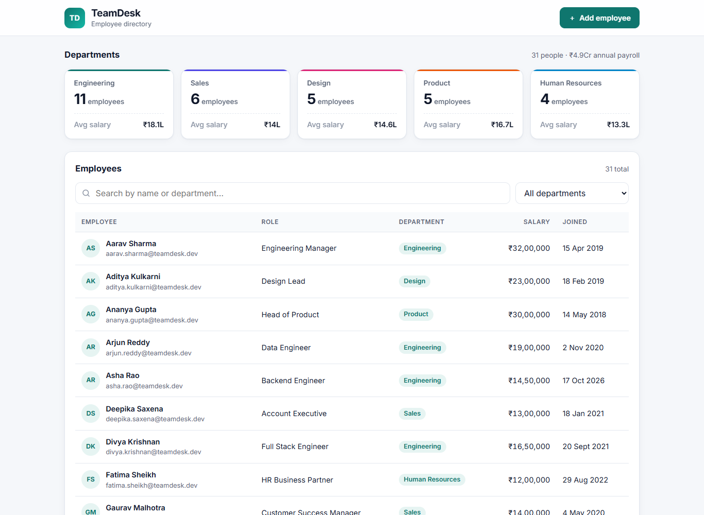
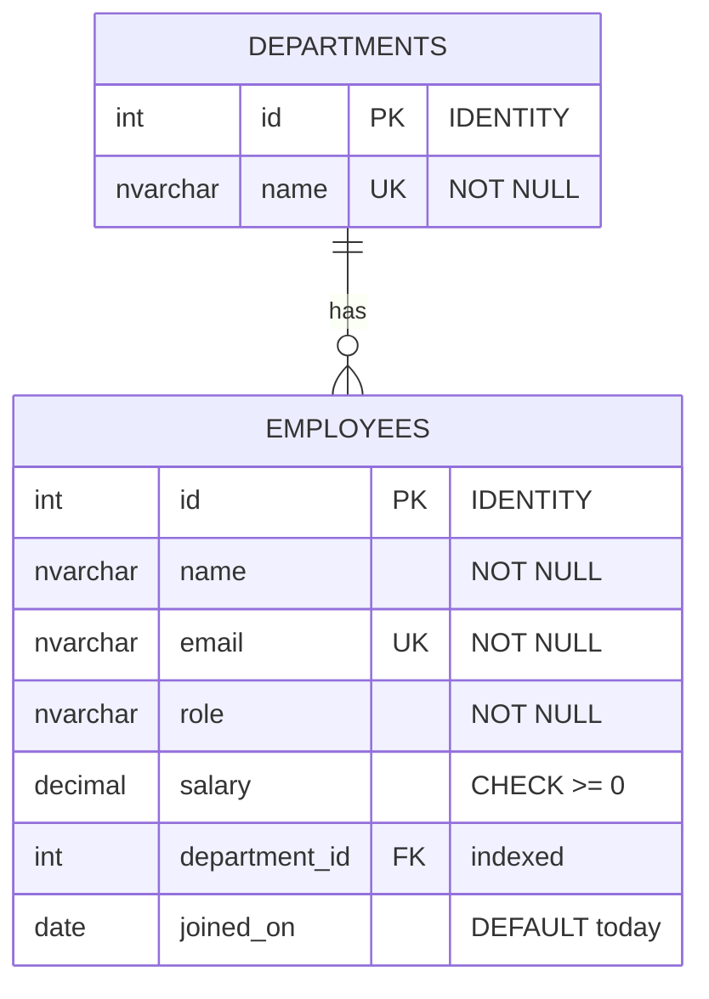

# TeamDesk: Employee Directory

A small full-stack employee directory that shows **SQL Server, Oracle, REST API and React** skills: search and filter employees, add new ones through a validated stored procedure, and see headcount and average salary per department.

**Stack:** SQL Server 2022 (Docker) · Oracle 23ai Free (optional, Docker) · Python FastAPI + pyodbc · React + TypeScript (Vite) · pytest · Vitest



## Features

- Employee table with **search** (by employee or department name) and a **department filter**. On phones the rows turn into cards.
- **Add employee** form with client-side validation. Server errors appear next to the right field, for example a duplicate email.
- **Department summary cards**: employee count and average salary, from a SQL `GROUP BY` report.
- Loading skeletons, error messages with retry, and salaries in Indian format (₹24,00,000, ₹18.5L).

## Database design



| Object | Type | Purpose |
| --- | --- | --- |
| `departments`, `employees` | Tables | One department has many employees (`employees.department_id` → `departments.id`) |
| `IX_employees_department_id` | Index | Fast filtering and JOINs by department |
| `vw_EmployeeDetails` | View | Employees joined with their department name. The API reads from it. |
| `usp_AddEmployee` | Stored procedure | Validates and inserts one employee, returns the new row |
| `vw_DepartmentSummary` | View | Count, average, min, max and total salary per department |
| `teamdesk_app` | Login / user | Least-privilege account the API connects with |

## SQL features used

**Schema and integrity** ([`01_schema.sql`](sql/01_schema.sql))
- `PRIMARY KEY` with `IDENTITY(1,1)` auto-increment ids
- `FOREIGN KEY` from employees to departments
- `UNIQUE` (department name, employee email), `CHECK (salary >= 0)`, `DEFAULT` joining date
- A **non-clustered index on the foreign key**: SQL Server indexes primary and unique keys automatically, but not foreign keys
- Re-runnable scripts with `DROP ... IF EXISTS`, dropping dependents (views, procedures, child table) before parents

**Data loading** ([`02_seed.sql`](sql/02_seed.sql))
- Multi-row `INSERT ... VALUES`, and `INSERT ... SELECT` joining a derived table to look up department ids by name
- A **transaction** with `SET XACT_ABORT ON`, so the seed is all-or-nothing
- `DBCC CHECKIDENT` to restart ids, guarded with `sys.identity_columns`: `RESEED 0` on a never-used table would start at 0, not 1

**Stored procedure and view** ([`03_procedures.sql`](sql/03_procedures.sql))
- `CREATE OR ALTER VIEW` hiding an `INNER JOIN`
- `CREATE OR ALTER PROCEDURE` with typed parameters, a default and an `OUTPUT` parameter
- Input validation with **`THROW` and custom error numbers** (50001 missing department, 50002 duplicate email, 50003 invalid input). The API maps them to HTTP 400 and 409.
- `BEGIN TRY / BEGIN CATCH` with `ROLLBACK` and re-`THROW`
- **Concurrency safety:** `WITH (UPDLOCK, HOLDLOCK)` on the duplicate-email check, so two simultaneous requests can't both insert the same email. A `CATCH` on error 2627/2601 is a second safety net.
- `SCOPE_IDENTITY()` to get the id created by *this* insert
- Returns the new row as a result set, so the API needs no second query

**Reporting** ([`04_reports.sql`](sql/04_reports.sql))
- `LEFT JOIN` + `GROUP BY` with `COUNT`, `AVG`, `MIN`, `MAX`, `SUM`. `COUNT(e.id)` returns 0 for empty departments, whereas `COUNT(*)` would return 1.
- `HAVING` with a subquery: departments paid above the company average
- A **CTE** plus the **window function** `ROW_NUMBER() OVER (PARTITION BY ... ORDER BY ...)`: the top earner per department

**Security** ([`05_app_user.sql`](sql/05_app_user.sql))
- A dedicated login with **least privilege**: `SELECT` on the views and `EXECUTE` on the procedure only. Direct `INSERT`, `UPDATE` and `DELETE` on tables are denied, and that was checked. Ownership chaining lets the procedure write anyway.
- The password is passed in as a `sqlcmd` scripting variable (`$(APP_PASSWORD)`) instead of being hard-coded
- On the API side: **parameterised queries only** (`?` placeholders). Wildcards in search text are escaped (`LIKE ... ESCAPE '\'`), so searching `50%` is literal and `'; DROP TABLE ...` just matches nothing.

### Oracle version

[`sql/oracle/teamdesk_oracle.sql`](sql/oracle/teamdesk_oracle.sql) builds the same schema, view, procedure and report for Oracle, with comments at each difference:

| SQL Server | Oracle |
| --- | --- |
| `INT IDENTITY(1,1)` | `NUMBER GENERATED BY DEFAULT AS IDENTITY` |
| `NVARCHAR(n)`, `DECIMAL(p,s)` | `VARCHAR2(n CHAR)`, `NUMBER(p,s)` |
| `DATE` (date only), `GETDATE()` | `DATE` (includes time), `TRUNC(SYSDATE)` |
| Case-insensitive `UNIQUE` (collation) | Unique **function-based index** on `LOWER(email)` |
| Multi-row `VALUES (...), (...)` | `INSERT ... SELECT ... FROM dual UNION ALL` |
| `CREATE OR ALTER` | `CREATE OR REPLACE` |
| `THROW 50001, 'msg', 1` | `RAISE_APPLICATION_ERROR(-20001, 'msg')` |
| `SCOPE_IDENTITY()` | `INSERT ... RETURNING id INTO p_new_id` |
| Procedure returns rows with `SELECT` | `OUT` parameter (or `SYS_REFCURSOR`), then query the view |
| `''` is an empty string | `''` **is NULL** |
| Auto-commit per statement | Explicit `COMMIT` |
| `TOP n` | `FETCH FIRST n ROWS ONLY` |
| `GO` batch separator | `/` after PL/SQL blocks |

## Run it locally

Requirements: [Docker Desktop](https://www.docker.com/products/docker-desktop/), Python 3.11+, Node 20+ and [ODBC Driver 18 for SQL Server](https://learn.microsoft.com/sql/connect/odbc/download-odbc-driver-for-sql-server). On Windows: `winget install Microsoft.msodbcsql.18`.

Ports: SQL Server **1433**, API **8002**, web **5175**.

### 1. Start SQL Server and create the database

```bash
cp .env.example .env                 # container passwords (change them if you like)
docker compose up -d                 # SQL Server 2022; wait ~20 s until "healthy": docker ps
```

Run all scripts in order (schema → seed → procedures → reports → app login):

```powershell
# Windows PowerShell (-ExecutionPolicy Bypass applies to this one command only)
powershell -ExecutionPolicy Bypass -File scripts\init-db.ps1
```

```bash
# macOS / Linux / Git Bash
./scripts/init-db.sh
```

Re-running the scripts resets the database to the seed data. You can also run a single file with sqlcmd inside the container:

```bash
docker exec -it teamdesk-sqlserver /opt/mssql-tools18/bin/sqlcmd -C -S localhost -U sa -P "<MSSQL_SA_PASSWORD>" -i /sql/04_reports.sql
```

Or connect with SSMS / Azure Data Studio to `localhost,1433` (user `sa`, "Trust server certificate" ticked).

### 2. Backend (FastAPI)

```bash
cd backend
python -m venv .venv
.venv\Scripts\activate               # macOS/Linux: source .venv/bin/activate
pip install -r requirements-dev.txt
cp .env.example .env                 # DB_PASSWORD must match APP_DB_PASSWORD in the root .env
uvicorn app.main:app --reload --port 8002
```

Interactive API docs: http://localhost:8002/docs

### 3. Frontend (React)

```bash
cd frontend
npm install
cp .env.example .env                 # VITE_API_URL=http://localhost:8002
npm run dev                          # http://localhost:5175
```

### Optional: Oracle

```bash
docker compose --profile oracle up -d oracle      # Oracle 23ai Free; first start takes a few minutes
docker exec -i teamdesk-oracle sqlplus -s teamdesk/TeamDesk_App1@FREEPDB1 < sql/oracle/teamdesk_oracle.sql
```

## API

| Method | Path | Description |
| --- | --- | --- |
| `GET` | `/employees?search=&department_id=` | Employees from `vw_EmployeeDetails`. `search` matches employee or department name. |
| `POST` | `/employees` | Calls `usp_AddEmployee`. **201** with the new employee. **400** for invalid input or an unknown department. **409** for a duplicate email. |
| `GET` | `/departments` | All departments |
| `GET` | `/reports/department-summary` | Rows of `vw_DepartmentSummary` |
| `GET` | `/health` | API and database check |

Every error is `{"detail": "<readable message>"}`. Errors raised inside the stored procedure keep their SQL message: SQL Server error numbers 50001/50003 become HTTP 400 and 50002 becomes 409. If the database is unreachable the API returns 503.

## Tests

```bash
cd backend && pytest     # 19 tests: 9 offline + 10 against the real database
cd frontend && npm test  # 9 tests
```

- **Backend:** the integration tests use the real SQL Server and seed data. Each test runs inside a transaction that is **rolled back**, so the database is never changed. They cover search (including literal `%`), the department filter, adding through the procedure (email trimmed and lower-cased), duplicate email in different case → 409, unknown department → 400, and the report numbers. Offline tests cover input validation → 400 and SQL error parsing. Integration tests are skipped automatically if SQL Server isn't running.
- **Frontend:** form validation, focus management, a 409 shown on the email field, and the table, empty and error states, and summary cards.

## Project structure

```
teamdesk/
├── sql/
│   ├── 01_schema.sql · 02_seed.sql · 03_procedures.sql · 04_reports.sql · 05_app_user.sql
│   └── oracle/teamdesk_oracle.sql
├── scripts/            # init-db.ps1 / init-db.sh: run the SQL scripts in the container
├── backend/
│   └── app/
│       ├── main.py         # routes + error mapping (SQL error number -> HTTP status)
│       ├── repository.py   # every SQL statement, parameterised
│       ├── db.py           # pyodbc connection (pooled) + SQL error parsing
│       ├── schemas.py      # Pydantic request/response models
│       └── config.py       # settings from .env
├── frontend/
│   └── src/
│       ├── App.tsx · api.ts · types.ts · validation.ts · format.ts
│       └── components/     # SummaryCards, EmployeeTable, EmployeeForm (+ __tests__)
└── docker-compose.yml  # SQL Server 2022 (+ optional Oracle Free)
```
